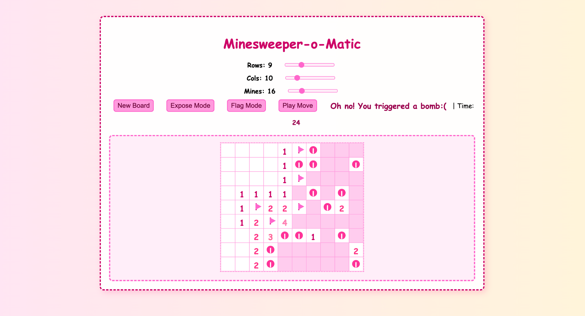
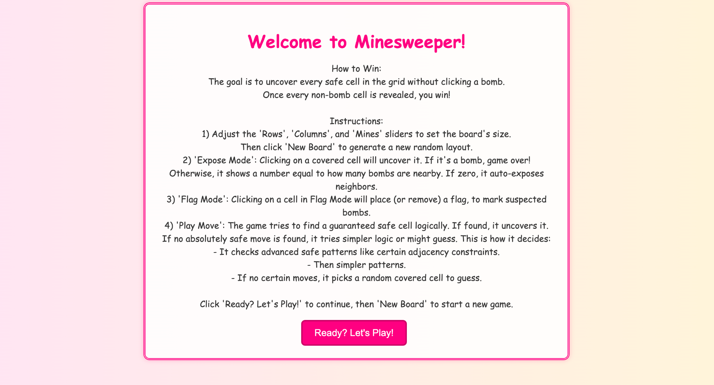

# Minesweeper-o-Matic

**Minesweeper in Haskell, with a browser-based interface and a constraint-driven move assistant.**

[](https://www.haskell.org/)
[](https://docs.haskellstack.org/)
[](LICENSE)



A configurable Minesweeper game built for **CSU44012 - Topics in Functional Programming** at **Trinity College Dublin (2024–2025)**. It combines an immutable board model, recursive zero-cell expansion, random mine placement and a browser interface using **Threepenny GUI** and SVG. The **Play Move** control can derive actions from numbered clues or attempt a guess when a logical deduction is unavailable.

## Features

- **Custom boards:** choose the number of rows, columns and mines before starting a game.
- **Random layouts:** Fisher–Yates shuffling selects distinct mine coordinates.
- **Minesweeper rules:** uncover safe cells, flag suspected mines, trigger zero-region expansion and win by exposing every safe cell.
- **Interactive SVG board:** colour-coded adjacency numbers, mine and flag graphics, a timer and end-of-game messages.
- **Move assistance:** deduce certain reveals or mine locations from adjacent counts and overlapping neighbour sets, with a random-guess fallback.
- **Automated game-rule tests:** deterministic board fixtures cover mine counts, safe reveals, flagging, loss, victory and logical deductions.

## Screenshots

| Welcome screen | Game board |
|:---:|:---:|
|  |  |

*Screenshots from the original project report.*

## How to Play

1. Select **Ready? Let's Play!** to open the game.
2. Adjust the **Rows**, **Cols** and **Mines** sliders, then select **New Board**.
3. Choose **Expose Mode** to uncover cells. A number indicates how many adjacent cells contain mines; an empty cell exposes its surrounding zero region.
4. Choose **Flag Mode** to mark or unmark suspected mines.
5. Select **Play Move** to ask the game to perform a deduction or guess.
6. Reveal every non-mine cell to win. Revealing a mine ends the game.

The game keeps at least one cell mine-free when configuring a custom board. Flagging a cell does not itself count as winning; all safe cells must be exposed.

## Build and Run

### Requirements

- [Haskell Stack](https://docs.haskellstack.org/en/stable/) installed and available on the command line.
- A browser to access the Threepenny GUI.
- An internet connection for the initial dependency download.

The project specifies **Stackage LTS 23.3**, based on GHC 9.8.4, through `stack.yaml`.

### Start the Game

```bash
# Clone the repository
git clone https://github.com/leahweldon/Minesweeper-o-Matic.git
cd Minesweeper-o-Matic

# Compile the library and executable
stack build

# Run the Threepenny server
stack exec minesweeper-project-exe
```

Open **http://localhost:3000** in a browser. The application serves `static/css/style.css` from the repository's `static/` directory, so run the commands from the repository root.

Stop the server with **Ctrl+C**.

### Run the Tests

```bash
stack test
```

The test runner exercises the pure board rules and inference engine with predictable fixtures, alongside a random board-initialisation check. Tests do not require an open browser window.

### Development Notes

- The first Stack build downloads the specified compiler and dependencies when they are not already installed.
- Threepenny serves the UI on `localhost:3000`; the browser communicates with the Haskell process while it is running.
- The user interface is designed for a local development session. The widest board sizes can scroll horizontally on narrower screens.
- Package configuration is provided in `package.yaml`, with a corresponding Cabal file for standard Haskell tooling.

## Design and Implementation

### Board Model

`src/Mine.hs` represents each cell using two separate dimensions:

- **`CellKind`** stores its contents: `Bomb` or `Open Int`, where the integer is the number of adjacent mines.
- **`Display`** stores its presentation state: `Covered`, `Uncovered` or `Flagged`.

A `Board` combines the dimensions and a two-dimensional grid of cells. Core actions return new board values rather than modifying shared data in place.

### Gameplay Rules

The engine places mines at randomly selected coordinates and computes the count for the eight neighbouring positions of each safe cell. Revealing a zero-valued cell recursively opens connected empty cells and their numbered boundary. Flagged cells remain protected from ordinary reveals.

Victory requires every safe cell to be uncovered. Revealing a mine ends play and exposes the remaining unflagged mines.

### Move Assistant

The solver derives moves from the same information visible to the player:

1. **Satisfied clues:** if the flagged neighbours account for a numbered cell's mine count, its other covered neighbours can be revealed.
2. **Fully constrained clues:** if the outstanding mine count equals the number of covered neighbours, those cells can be flagged.
3. **Overlapping clues:** if one clue's covered-neighbour set is contained within another's, the difference between their mine counts can identify additional safe cells or mines.
4. **Guessing:** when no logical move is available, one covered cell is selected at random. This move can trigger a mine.

Logical deductions **assume that player-placed flags correctly identify mines**. An incorrect flag can therefore invalidate an inference. The assistant does not inspect hidden mine locations to choose its next action.

### Interface

`src/GameUI.hs` uses Threepenny GUI to manage browser controls, game modes, timers, SVG rendering and event handlers. Game state is held in an `IORef` at the interface boundary; board transformations remain in the game-logic module. The project retains its original pink theme and SVG cell illustrations.

## Repository Structure

```text
.
├── app/
│   └── Main.hs                # Application entry point
├── src/
│   ├── GameUI.hs              # Browser interface and events
│   ├── Mine.hs                # Board rules and move assistant
│   └── Lib.hs                 # Randomisation utilities
├── test/
│   └── Spec.hs                # Game rules and solver tests
├── static/css/
│   └── style.css              # Interface styles
├── docs/
│   ├── Project-Report.pdf     # Academic project report
│   └── screenshots/          # Original interface screenshots
├── package.yaml              # Package configuration
├── minesweeper-project.cabal # Cabal package definition
├── stack.yaml                # Stackage snapshot
└── LICENSE
```

## Academic Context

**Module:** CSU44012 - Topics in Functional Programming  
**Project:** Project 2 - Minesweeper-o-Matic  
**Institution:** Trinity College Dublin  
**Academic year:** 2024-2025  
**Developer:** Leah Weldon

The original [project report](docs/Project-Report.pdf) describes the coursework requirements, implementation, GUI and move-selection approach.

## License

Distributed under the [BSD 3-Clause License](LICENSE).
