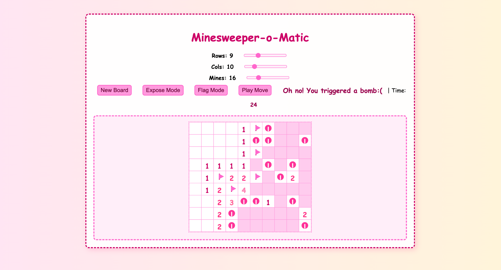
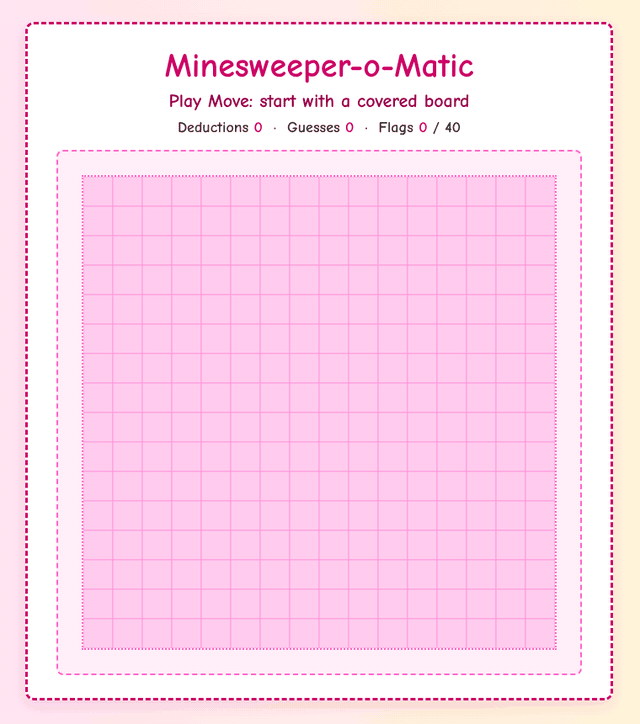
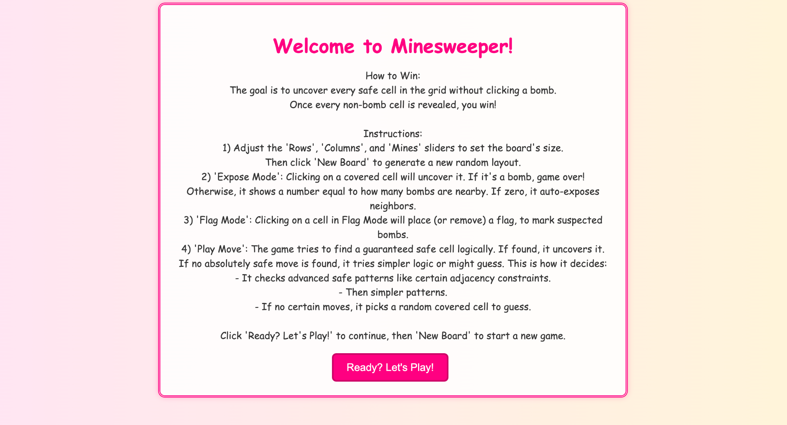

# Minesweeper-o-Matic

**Minesweeper in Haskell, with a browser interface and a constraint-driven move assistant that clears boards on its own.**

[](https://github.com/leahweldon/Minesweeper-o-Matic/actions/workflows/ci.yml)
[](https://www.haskell.org/)
[](https://docs.haskellstack.org/)
[](LICENSE)



A configurable Minesweeper game built for **CSU44012 Topics in Functional Programming** at **Trinity College Dublin (2024–25)**. The game logic is a pure, immutable board model; the interface is **Threepenny GUI** drawing the board as SVG in the browser. The **Play Move** button asks the move assistant for its next action: it reads only the numbers a player can see, deduces cells that must be safe or must be mines, and guesses only when no certain move exists.

## Highlights

- **88% of moves are pure deduction** on a beginner board, rising to **97.6%** on the largest board, measured over 4,000 automated games.
- **79% of beginner games won** by the assistant alone once its opening reveal lands safely, and **91%** on the largest board.
- **Pure game core:** every rule (reveal, flood fill, flag, win, loss) is a function from board to board, with the browser layer kept to the edges.
- **Tested and benchmarked in CI:** game-rule tests and a seeded solver benchmark run on every push.

## The Move Assistant in Action



*A 16 × 16 board with 40 mines, cleared by pressing **Play Move** repeatedly: 98 deductions and 2 guesses. The outlined cell is the assistant's latest move. Frames are drawn from the game engine's board states using the interface's SVG styling.*

## Solver Results

`bench/SolverBenchmark.hs` plays complete games using nothing but `autoMove`, the function behind **Play Move**, from the first click to the end of the game. Results for 1,000 games per board (seed 2025):

| Board | Size | Mines | Win rate | Win rate after a safe opening | Moves deduced | Guesses per game |
|---|---|---:|---:|---:|---:|---:|
| Beginner | 9 × 9 | 10 | 68.2% | 78.8% | 88.0% | 2.21 |
| Default | 8 × 10 | 15 | 32.4% | 39.8% | 83.5% | 3.17 |
| Intermediate | 16 × 16 | 40 | 48.1% | 57.3% | 95.6% | 2.92 |
| Largest | 20 × 30 | 50 | 83.9% | 91.0% | 97.6% | 1.84 |

- **Default** is the board the game opens with; **Largest** uses the maximum slider settings.
- The opening move is a random reveal on a fully covered board, so the second column shows performance once the board has given the assistant something to reason about.
- **Mine density drives difficulty:** the default board is 19% mines, while the largest board is 8%, so long chains of deductions are possible there.

Reproduce the table with:

```bash
stack bench                                  # 1,000 games per board, seed 2025
stack bench --benchmark-arguments "200 7"    # 200 games per board, seed 7
```

The raw output is in [`results/solver-benchmark.md`](results/solver-benchmark.md).

## How the Assistant Decides

Each uncovered number becomes a constraint: *this set of covered neighbours contains exactly k mines*, where k is the number minus any flags already placed around it. The assistant then applies three rules:

1. **Satisfied clue:** if k = 0, every covered neighbour is safe to reveal.
2. **Saturated clue:** if k equals the number of covered neighbours, every one of them is a mine and can be flagged.
3. **Subset rule:** if clue A's covered cells are a strict subset of clue B's, then the cells in B but not A hold exactly k<sub>B</sub> − k<sub>A</sub> mines. When that is 0 they are safe; when it equals their count they are all mines. This handles classic patterns such as 1-2 and 1-1 along an edge.

Safe reveals take priority over flags. When no rule applies, the assistant reveals a covered cell chosen at random. It never looks at hidden mine positions.

```haskell
deduceMove :: Board -> Maybe Move
deduceMove board =
    let constraints = clues board
        directMoves = concatMap singleClueMoves constraints
        overlappingMoves =
            [ move
            | first <- constraints
            , second <- constraints
            , move <- subsetMoves first second
            ]
        candidates = directMoves ++ overlappingMoves
        reveals = [move | move@(Reveal _) <- candidates]
        flags = [move | move@(PlaceFlag _) <- candidates]
    in listToMaybe (reveals ++ flags)
```

## Features

- **Custom boards:** choose the rows, columns and mines before starting a game.
- **Random layouts:** a Fisher–Yates shuffle selects distinct mine positions.
- **Minesweeper rules:** uncover safe cells, flag suspected mines, open empty regions automatically and win by exposing every safe cell.
- **Interactive SVG board:** colour-coded numbers, mine and flag graphics, a timer and end-of-game messages.
- **Move assistance:** one click performs the next deduction, or a guess when the board offers no certain move.

## Screenshots

| Welcome screen | Game board |
|:---:|:---:|
|  |  |

## How to Play

1. Select **Ready? Let's Play!** to open the game.
2. Adjust the **Rows**, **Cols** and **Mines** sliders, then select **New Board**.
3. Choose **Expose Mode** to uncover cells. A number shows how many adjacent cells contain mines; an empty cell opens its surrounding region.
4. Choose **Flag Mode** to mark or unmark suspected mines.
5. Select **Play Move** to let the assistant take the next move.
6. Reveal every safe cell to win.

## Build and Run

### Requirements

- [Haskell Stack](https://docs.haskellstack.org/en/stable/)
- A web browser

The project uses **Stackage LTS 23.3** (GHC 9.8.4), set in `stack.yaml`. The first build downloads the compiler and dependencies.

### Start the Game

```bash
git clone https://github.com/leahweldon/Minesweeper-o-Matic.git
cd Minesweeper-o-Matic

stack build
stack exec minesweeper-project-exe
```

Open **http://localhost:3000** in a browser. The server reads `static/css/style.css`, so run it from the repository root. Stop it with **Ctrl+C**.

### Run the Tests and Benchmark

```bash
stack test     # game rules and deductions on fixed boards
stack bench    # solver benchmark
```

The tests check random board creation, then use hand-built boards with known mine positions to cover adjacency counts, single reveals, flood fill, flagging, loss, victory, both deduction rules and a fully covered board.

## Design

### Board Model

`src/Mine.hs` describes each cell along two independent axes:

- **`CellKind`**: what the cell contains, either `Bomb` or `Open Int` with its adjacent-mine count.
- **`Display`**: what the player sees, either `Covered`, `Uncovered` or `Flagged`.

A `Board` pairs the dimensions with a grid of cells. Every game action returns a new board, which keeps the rules easy to test and lets the benchmark replay thousands of games with no shared state.

### Gameplay Rules

Mine counts are computed once when the board is created. Revealing a zero cell recursively opens the connected empty region and its numbered border. Flagged cells are protected from reveals. Revealing a mine ends the game and uncovers the remaining mines; uncovering every safe cell wins it.

### Interface

`src/GameUI.hs` uses Threepenny GUI for the controls, game modes, timer and SVG rendering. Game state lives in a single `IORef` at the interface boundary, and every change to the board goes through the pure functions in `Mine.hs`.

## Repository Structure

```text
.
├── app/
│   └── Main.hs                  # Entry point
├── src/
│   ├── GameUI.hs                # Browser interface and events
│   ├── Mine.hs                  # Board rules and move assistant
│   └── Lib.hs                   # Fisher–Yates shuffle and sampling
├── test/
│   └── Spec.hs                  # Game-rule and deduction tests
├── bench/
│   └── SolverBenchmark.hs       # Plays full games with the assistant
├── results/
│   └── solver-benchmark.md      # Benchmark output
├── static/css/
│   └── style.css                # Interface styles
├── docs/
│   ├── Project-Report.pdf       # Project report
│   ├── solver-replay.gif        # Assistant clearing a board
│   └── screenshots/             # Interface screenshots
├── .github/workflows/ci.yml     # Build, test and benchmark
├── package.yaml
├── minesweeper-project.cabal
├── stack.yaml
└── LICENSE
```

The [project report](docs/Project-Report.pdf) covers the requirements, implementation, interface and move-selection approach in more detail.

## License

Distributed under the [BSD 3-Clause License](LICENSE).
